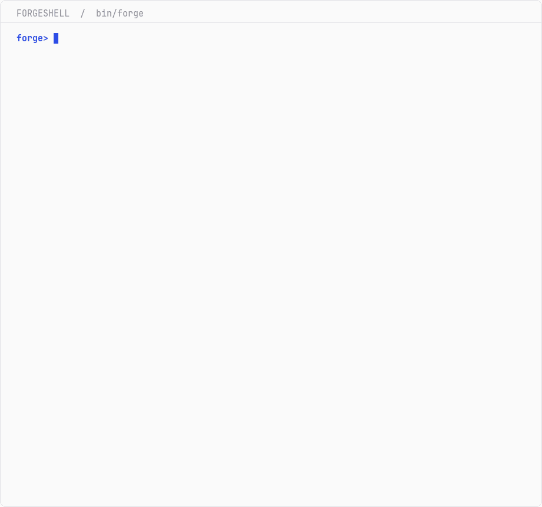

# ForgeShell

[](https://github.com/JeyaVardhan-L/ForgeShell/actions/workflows/ci.yml)

A Unix shell written from scratch in C for Linux. It runs pipelines, redirections and background jobs with full job control, and it has built-in commands that read live process data straight from `/proc`.



There's a companion site that explains every line of the code, with interactive figures and a set of interview-style questions: **[jeyavardhan-l.github.io/ForgeShell](https://jeyavardhan-l.github.io/ForgeShell/)**.

## What it does

- Runs programs with `fork`, `execvp` and `waitpid`, and reports exit statuses the way Bash does: 127 when a command isn't found, 126 when it can't be executed, and 128 + n when a signal kills it.
- Pipelines of any length, plus `<`, `>`, `>>` and `2>` redirection.
- Single quotes, double quotes and backslash escapes, handled by a real lexer rather than splitting on spaces.
- Job control. Each pipeline gets its own process group and the terminal is handed to whichever job is in the foreground, so Ctrl+C, Ctrl+Z, `&`, `jobs`, `fg` and `bg` behave the way you'd expect.
- Three observability builtins that read `/proc` directly: `inspect <pid>` for a full report on one process, `monitor <pid> [seconds]` for live CPU and memory, and `ps` for a process list. The report shows which `/proc` file every number came from.

## Build and run

You need Linux, gcc or clang, and make. Python 3 is only needed for the tests.

```bash
git clone https://github.com/JeyaVardhan-L/ForgeShell.git
cd ForgeShell
make
./bin/forge
```

| Command | What it does |
|---|---|
| `make` | Builds `bin/forge`, the parser test binary and the demo programs |
| `make test` | Runs the full test suite |
| `make debug` | Unoptimized build with debug symbols |
| `make asan` | Build with AddressSanitizer and UndefinedBehaviorSanitizer |
| `make clean` | Removes all build output |

## Try it

The repo includes three small programs to experiment with: `bin/leak` holds memory, `bin/spin` burns CPU, and `bin/sigtrap` catches signals.

```text
forge> printf "cherry\napple\nbanana\n" | sort | head -n 2
apple
banana
forge> ./bin/leak 300 60 > /dev/null &
[1] 25978
forge> inspect 25978          # full /proc report: about 300 MB resident
forge> ./bin/spin 600 1       # burns CPU; press Ctrl+Z
[2]+ Stopped                 ./bin/spin 600 1
forge> bg
forge> jobs
forge> monitor <spin's PID>   # about 100% CPU; Ctrl+C to stop
forge> fg 2                   # Ctrl+C to end it
forge> exit
```

## Builtins

| Builtin | Description |
|---|---|
| `cd [dir]` | Change directory. Supports `~` and `-` |
| `pwd` | Print the working directory |
| `export KEY=VALUE` | Set an environment variable for later commands |
| `unset KEY` | Remove an environment variable |
| `jobs` | List background and stopped jobs |
| `fg [%n]` | Resume a job in the foreground |
| `bg [%n]` | Resume a stopped job in the background |
| `inspect <pid>` | Identity, memory, CPU time, paths and open files of a process |
| `monitor <pid> [s]` | Sample CPU % and memory every `s` seconds until Ctrl+C |
| `ps` | List every process, read from `/proc` |
| `help` | Show the built-in reference |
| `exit [code]` | Leave the shell |

## How it's put together

`src/main.c` is the whole shell in one loop: reap finished background jobs, print the prompt, read a line, parse it, run it, free it.

`src/parser.c` turns the line into tokens and then into a linked list of commands, each with an `argv` ready for `execvp` and up to three redirect targets. `src/executor.c` runs a lone builtin inside the shell, or forks one process per pipeline stage, creates the pipes, applies redirects with `dup2`, and puts every process of the job in one process group. `src/jobs.c` owns the job table and moves the terminal between the shell and its jobs with `tcsetpgrp`. `src/signals.c` decides which signals the shell ignores and resets them in each child. `src/proc.c` parses `/proc/<pid>/stat`, `status`, `cmdline`, `exe`, `cwd` and `fd/`.

The guide covers each of these in depth: [the loop](https://jeyavardhan-l.github.io/ForgeShell/#loop), [the parser](https://jeyavardhan-l.github.io/ForgeShell/#parser), [processes](https://jeyavardhan-l.github.io/ForgeShell/#process), [file descriptors](https://jeyavardhan-l.github.io/ForgeShell/#fds), [pipes](https://jeyavardhan-l.github.io/ForgeShell/#pipes), [signals](https://jeyavardhan-l.github.io/ForgeShell/#signals), [job control](https://jeyavardhan-l.github.io/ForgeShell/#jobs) and [/proc](https://jeyavardhan-l.github.io/ForgeShell/#proc). The [annotated source](https://jeyavardhan-l.github.io/ForgeShell/source.html) has a note beside every block of every file.

## Tests

`make test` runs 26 checks. Unit tests in `tests/test_parser.c` call the parser directly and check its structures. Integration tests in `tests/test_runner.py` run the real binary with scripted input and check output, exit codes and the files it creates. They cover exit statuses, quoting, all four redirects, multi-stage pipelines, a 30,000-line stream through a pipe, descriptor leaks (counted through `/proc/self/fd`), builtins, background jobs and the `/proc` commands.

CI runs the suite on every push with gcc and clang, each in a normal build and a sanitizer build. A second CI job checks that the guide's annotated source still matches the code.

## Limitations

- No `;`, `&&` or `||`, and no `if`, `for` or functions.
- No `$VAR` or `$?` expansion. Exported variables do reach child programs.
- No globbing (`*.c`), no `2>&1`, no heredocs, and no command history or line editing.
- `exit` doesn't warn about stopped jobs.
- Interactive job control (Ctrl+Z, terminal hand-off) is exercised by hand and by the demo recorder, but not by the automated tests yet, which run without a terminal.

The guide's last chapter lists the smaller differences from Bash and the bugs that were found and fixed while writing it.

## Repository layout

```text
src/        shell source
include/    headers
tests/      parser unit tests and the integration test runner
examples/   demo programs: spin, leak, sigtrap
tools/      demo GIF recorder and the guide's build script
docs/       the guide website (served by GitHub Pages)
notes/      earlier topic notes in Markdown
```

## License

MIT. See [LICENSE](LICENSE).
